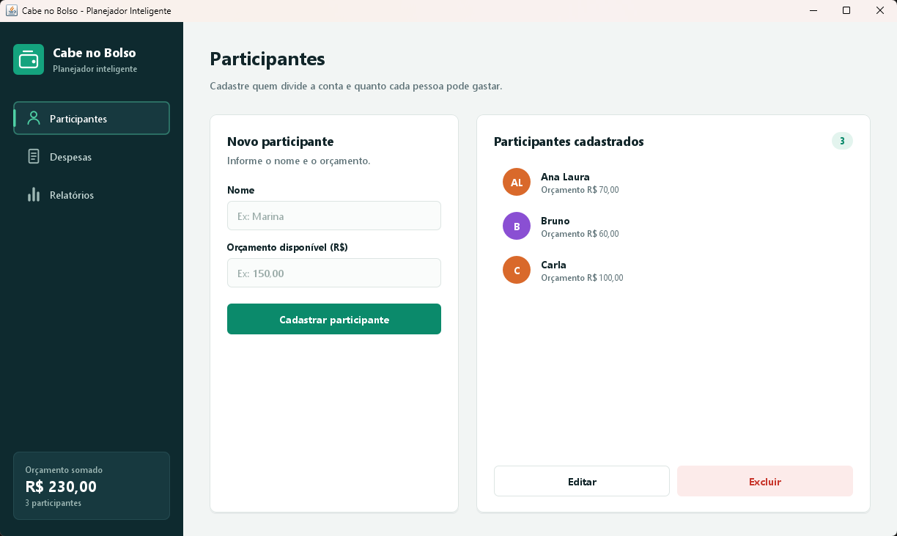

# Cabe no Bolso — Planejador de Despesas Compartilhadas

Aplicação desktop em Java Swing para planejamento de despesas compartilhadas em grupo, com suporte a rateio fixo (divisão exata em centavos por código crescente) e por pessoa, controle de orçamentos individuais, persistência por serialização e simulador de alternativas viáveis[cite: 1, 2, 3, 9].



## Tecnologias e Requisitos
- **JDK:** Versão 17 ou superior.
- **Dependências Externas:** Nenhuma (apenas bibliotecas padrão `javax.swing`, `java.awt`, `java.io` e `java.util`).

## Organização das Pastas (Arquitetura MVC)
```text
src/
 ├── controlador/      # ControladorPlanejamento (mediação entre Visão, Modelo e Persistência)
 ├── modelo/           # Planejamento, Participante, Despesa, DespesaFixa, DespesaPorPessoa, SimuladorAlternativas
 ├── persistencia/     # Interface PersistenciaDados e implementação GerenciadorArquivo
 ├── principal/        # Ponto de entrada da aplicação (Main)
 └── visao/            # Interface gráfica Swing/Java2D (TelaPrincipal)
```
* O arquivo `planejamento.ser` na raiz armazena o planejamento serializado e é atualizado automaticamente a cada operação.

## Como Compilar e Executar

### Via IDE (IntelliJ, Eclipse ou VS Code)
1. Abra a pasta do projeto com o **JDK 17+** configurado.
2. Execute a classe `src/principal/Main.java`.

### Via Terminal (Windows CMD)
```cmd
mkdir out
dir /s /B src\*.java > sources.txt
javac -encoding UTF-8 -d out @sources.txt
java -cp out principal.Main
```

### Via Terminal (Windows PowerShell)
```powershell
New-Item -ItemType Directory -Force -Path out | Out-Null
$files = Get-ChildItem -Recurse -Path src -Filter *.java | ForEach-Object { $_.FullName }
javac -encoding UTF-8 -d out $files
java -cp out principal.Main
```

### Via Terminal (Linux / macOS)
```bash
mkdir -p out
javac -encoding UTF-8 -d out $(find src -name "*.java")
java -cp out principal.Main
```

## Roteiro de Validação e Testes

### 1. Caso de Referência (Passeio da Turma)
1. **Participantes:**
   - `1 - Ana` — Orçamento: **R$ 70,00**
   - `2 - Bruno` — Orçamento: **R$ 60,00**
   - `3 - Carla` — Orçamento: **R$ 70,00**
2. **Despesas:**
   - **Transporte** | Fixa | R$ 90,00 | Essencial | Ana, Bruno e Carla
   - **Almoço** | Por Pessoa | R$ 20,00 | Essencial | Ana, Bruno e Carla
   - **Atividade recreativa** | Fixa | R$ 30,00 | Opcional (Prioridade 3) | Ana e Carla
   - **Sobremesa** | Por Pessoa | R$ 10,00 | Opcional (Prioridade 1) | Ana, Bruno e Carla
3. **Resultado esperado (na aba Relatórios -> Gerar relatório):**
   - **Ana:** R$ 75,00 (excede o orçamento em R$ 5,00)
   - **Bruno:** R$ 60,00 (dentro do limite)
   - **Carla:** R$ 75,00 (excede o orçamento em R$ 5,00)
   - **Custo total do planejamento:** R$ 210,00

### 2. Testes Adicionais Obrigatórios
- **Centavos no rateio:** Cadastrar despesa fixa de R$ 100,00 para os códigos `1`, `2` e `3` resulta em **R$ 33,34**, **R$ 33,33** e **R$ 33,33** respectivamente (soma R$ 100,00).
- **Entrada ou vínculo inválido:** Tentar cadastrar despesa sem participantes, com valor $\le 0$ ou campo vazio exibe mensagem de validação e mantém o estado anterior intacto.
- **Alteração de orçamento:** No caso principal, editar o orçamento de Ana para **R$ 80,00** mantém seu custo em **R$ 75,00**, alterando sua situação para dentro do limite.
- **Exclusão de despesa:** No caso principal original, excluir *Atividade recreativa* recalcula os totais para **R$ 60,00 por pessoa** e **R$ 180,00 no total**.
- **Salvar e reiniciar:** Fechar e reabrir a aplicação carrega automaticamente `planejamento.ser`, restaurando participantes, despesas, vínculos e resultados sem duplicar registros.
- **Problema no arquivo:** Remover ou corromper `planejamento.ser` com o sistema aberto e clicar em **Carregar** exibe mensagem clara de erro, **preserva o planejamento atual em uso** e oferece a opção de iniciar um planejamento vazio.

### 3. Objetivo Extra: Simulador de Alternativas
- **Cenário viável (orçamentos originais do caso principal):** Clicar em **Simular alternativas** mantém *Transporte*, *Almoço* e *Atividade recreativa* (prioridade 3) e retira *Sobremesa* (prioridade 1), resultando em **Ana R$ 65,00**, **Bruno R$ 50,00**, **Carla R$ 65,00** e **Total R$ 180,00**, sem alterar o planejamento original.
- **Cenário sem solução:** Editar o orçamento de Ana para **R$ 40,00** e rodar o simulador informa ausência de solução viável, indicando que suas despesas essenciais somam **R$ 50,00** (excesso de R$ 10,00).

## Decisões de Modelagem e POO
- **Arquitetura MVC:** Separação em pacotes (`visao`, `controlador`, `modelo`, `persistencia`, `principal`), isolando regras de cálculo e validação no domínio.
- **Abstração, Herança e Polimorfismo:** `Despesa` define o contrato abstrato `calcularRateio()`, especializado por `DespesaFixa` e `DespesaPorPessoa`.
- **Inversão de Dependência na Persistência:** `ControladorPlanejamento` depende da interface `PersistenciaDados`, desacoplando o domínio da serialização em arquivo (`GerenciadorArquivo`).
